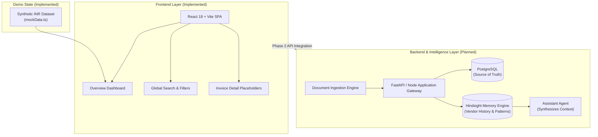
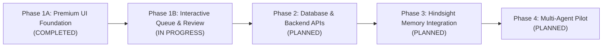

# LedgerMind

> **Memory-Powered Accounts Payable Exception Agent**  
> *Evidence-backed AP intelligence combining structured financial records with contextual memory for human-in-the-loop exception resolution.*

---

## 📌 Executive Overview

Accounts Payable (AP) departments process thousands of vendor invoices every month. When discrepancies arise—such as tariff variances, unit price mismatches, freight surcharges, or duplicate docket numbers—finance teams are often forced into manual, time-consuming investigation across fragmented email threads, contract PDFs, and ERP archives.

**LedgerMind** is designed to address this operational bottleneck. By pairing deterministic financial validation from business databases with contextual memory, LedgerMind aims to assist finance specialists with historical dispute context, vendor patterns, and evidence-backed resolution proposals while keeping human decision-makers firmly in control of all approvals and disbursements.

> [!NOTE]  
> **Current Project Phase (Phase 1A / 1A.1):**  
> The current repository contains the **Frontend Design Foundation and Interactive Overview Dashboard**. All metric indicators, activity streams, and variance amounts reflect curated synthetic INR demo data. Backend services, database persistence, LLM reasoning, and Hindsight memory integration are architectural specifications planned for future phases.

---

## ⚡ The Problem: The AP Exception Trap

Traditional enterprise ERPs and rule-based AP workflows struggle with nuanced real-world commerce:

1. **Repetitive Discrepancy Investigation:** Finance officers repeatedly re-investigate identical vendor pricing anomalies because past resolution rationales are trapped in offline email chains.
2. **Context Blindness in Pure Rule Engines:** Legacy systems trigger binary approval or rejection alerts without recalling whether a 5% freight markup was previously authorized for urgent monsoon shipments.
3. **Risks of Unchecked AI Automation:** Black-box LLMs that autonomously approve disbursements or calculate tax liabilities introduce unacceptable financial, compliance, and hallucination risks.

---

## 💡 The LedgerMind Solution

LedgerMind proposes a **bifurcated intelligence architecture**:

```
+-------------------------------------------------------------+
|                     LedgerMind Engine                       |
|                                                             |
|   +--------------------------+  +------------------------+  |
|   |   Structured Database    |  |  Context Memory Layer  |  |
|   |  (System of Financial   |  |   (Hindsight Memory    |  |
|   |          Truth)          |  |   Pattern Recognition) |  |
|   |                          |  |                        |  |
|   | • Deterministic Match    |  | • Vendor Habit Tracking|  |
|   | • Ledger Quantities      |  | • Past Dispute History |  |
|   | • Tax & Currency Math    |  | • Resolution Context   |  |
|   +-------------+------------+  +-----------+------------+  |
|                 \                          /                |
|                  \                        /                 |
|                   v                      v                  |
|             +----------------------------------+            |
|             | Evidence-Backed Assistant Engine |            |
|             +-----------------+----------------+            |
|                               |                             |
+-------------------------------|-----------------------------+
                                v
               +----------------------------------+
               |  Human Reviewer (AP Specialist)  |
               |  • Discretionary Override        |
               |  • Final Approval & Disbursement |
               +----------------------------------+
```

### Architectural Principles & Boundaries
- **Deterministic Arithmetic:** System calculations, ledger math, and matching rules run deterministically on structured data. LedgerMind never delegates monetary addition or tax computation to an LLM.
- **Relational Source of Truth:** SQL/ERP systems remain the authoritative record for invoices, purchase orders, goods receipt notes (GRNs), and vendor master data.
- **Contextual Memory Layer:** Hindsight serves as a temporal context engine, indexing past dispute resolutions and vendor correspondence patterns to explain *why* an exception might exist.
- **Human Oversight:** LedgerMind does not autonomously approve disbursements or trigger bank transfers. The agent presents findings; human AP leaders decide.

---

## ✨ Implemented Features (Phase 1A / 1A.1)

The current repository provides a production-grade, navigable React frontend featuring:

| Feature | Description | Status |
| :--- | :--- | :---: |
| **Enterprise Dark Finance Shell** | Midnight navy aesthetic (`#0B0F19`), restrained cyan/teal accents, subtle borders, and readable typography designed for financial operators. | **Implemented** |
| **Collapsible Navigation Sidebar** | Persistent menu with collapsible states (`w-64` to `w-20`), route indicators, live badges, and transparent `"Demo Mode"` indicators. | **Implemented** |
| **Multi-Entity Selector** | Switch between synthetic business profiles (*Nexus Logistics Pvt Ltd*, *Astra Biotech India*, *Kaveri Renewable Energy*). | **Implemented** |
| **KPI Metric Cards** | 4 high-contrast KPI cards displaying Total Invoices, Pending Review, Open Exceptions, and Resolved Invoices with period-over-period trends in INR. | **Implemented** |
| **Interactive Activity Chart** | Multi-series area chart (built with Recharts) illustrating ingestion trends versus exception spikes across interactive 7D, 30D, and 90D windows. | **Implemented** |
| **Exception Breakdown Panel** | Visual distribution tracking Unit Price Mismatches, Quantity Variances, Duplicate Dockets, Missing Information, and Other Exceptions with INR amounts. | **Implemented** |
| **Recent Invoices Table** | Structured data table with non-wrapping columns, truncated vendor names, custom status badges, and search filtering across IDs, vendors, and POs. | **Implemented** |
| **Invoice Details Routing** | Deep-linkable route (`/invoices/:id`) displaying invoice parameters, line-item metadata, and variance notes from passed state. | **Implemented** |
| **Audit & Resolution Timeline** | Event stream demonstrating human review checkpoints, 3-way match validation checks, and flagged variance alerts. | **Implemented** |
| **Memory Insights Boundary** | Dedicated route (`/memory-insights`) featuring the required safety disclosure: *"Demo memory preview — Hindsight not connected yet."* | **Implemented** |

---

## 🛠️ Technology Stack

### Current Frontend Stack
- **Framework:** [React 18.3](https://react.dev/) + [TypeScript](https://www.typescriptlang.org/)
- **Bundler & Tooling:** [Vite 6](https://vite.dev/) with route-level code splitting (`React.lazy` & `Suspense`)
- **Styling:** [Tailwind CSS 3.4](https://tailwindcss.com/) + PostCSS + Autoprefixer
- **UI Components & Icons:** [Lucide React](https://lucide.dev/)
- **Data Visualization:** [Recharts 2.13](https://recharts.org/)
- **Routing:** [React Router 6.28](https://reactrouter.com/)
- **Utility Libraries:** `clsx`, `tailwind-merge`

### Target Architecture (Future Roadmap)
- **Contextual Memory:** Hindsight Memory Engine
- **Backend API:** Python / FastAPI or Node.js (To be integrated in Phase 2)
- **Database:** PostgreSQL for deterministic invoice & vendor state
- **Document Extraction:** OCR / Structured Document Parsers for PDF ingestion

---

## 🏛️ System Architecture



---

## 📂 Repository Structure

The repository follows a clean, modular React component architecture:

```
AP-Memory/
├── index.html                   # HTML entry point with dark theme meta
├── package.json                 # Dependency definitions & scripts
├── package-lock.json            # Deterministic lockfile
├── postcss.config.js            # PostCSS configuration
├── tailwind.config.js           # Dark finance palette & typography extension
├── tsconfig.json                # TypeScript compiler configuration
├── vite.config.ts               # Vite configuration (port 5173, host enabled)
└── src/
    ├── main.tsx                 # React DOM mount point
    ├── App.tsx                  # Router setup with lazy-loaded routes
    ├── index.css                # Tailwind directives & custom scrollbars
    ├── types/
    │   └── index.ts             # TypeScript interfaces (Invoice, KPI, Event, Company)
    ├── data/
    │   └── mockData.ts          # Curated synthetic INR demo datasets
    ├── lib/
    │   └── utils.ts             # Tailwind merger (cn) & INR currency formatter
    ├── components/
    │   ├── common/
    │   │   ├── Badge.tsx        # Semantic status & exception indicator badges
    │   │   ├── Button.tsx       # Button variants (primary, secondary, outline, ghost)
    │   │   └── Card.tsx         # Dark midnight-navy surfaces with border accents
    │   ├── layout/
    │   │   ├── AppLayout.tsx    # Responsive shell container
    │   │   ├── Header.tsx       # Search, entity switcher, notifications, profile
    │   │   └── Sidebar.tsx      # Collapsible navigation sidebar
    │   └── dashboard/
    │       ├── ActivityChart.tsx       # Recharts area trend graph (7D / 30D / 90D)
    │       ├── ActivityTimeline.tsx    # Human-in-the-loop audit stream
    │       ├── ExceptionBreakdown.tsx  # Category distribution & amount progress bars
    │       ├── KPICards.tsx            # 4 metric cards with trends
    │       └── RecentInvoicesTable.tsx # Tabular invoice view with search filtering
    └── pages/
        ├── OverviewPage.tsx            # Complete Phase 1A dashboard
        ├── InvoiceDetailsPlaceholder.tsx # Deep-linked invoice details view
        └── PlaceholderPage.tsx         # Safety placeholder for future modules
```

---

## 🚀 Getting Started

### Prerequisites
- [Node.js](https://nodejs.org/) (Version 18.x or 20.x recommended)
- `npm` (Version 9.x or 10.x)

### 1. Clone the Repository
```bash
git clone https://github.com/jagadesh-jpg/LedgerMind.git
cd LedgerMind
```

### 2. Install Dependencies
```bash
npm install
```

### 3. Run the Development Server
```bash
npm run dev
```
The application will launch locally at:
```
http://localhost:5173/
```

### 4. Build for Production
To verify TypeScript compilation and produce an optimized distribution bundle:
```bash
npm run build
```
The output will be generated inside the `dist/` directory.

### 5. Preview Production Build
```bash
npm run preview
```

---

## 🗺️ Development Roadmap



- [x] **Phase 1A (Current):** Premium Dark Finance UI foundation, Overview Dashboard, 4 KPI cards, interactive 7D/30D/90D Recharts trend graph, exception category breakdown, searchable invoice table, and router shell.
- [ ] **Phase 1B (Next):** Full Invoice Queue interface, 3-way matching visualizer (PO vs. GRN vs. Invoice), line-item discrepancy inspector, and interactive resolution rationale input.
- [ ] **Phase 2:** PostgreSQL schema design, FastAPI backend integration, and deterministic rule validation engine.
- [ ] **Phase 3:** Hindsight Memory layer connection for contextual vendor history, policy precedent lookup, and recurring anomaly explanations.
- [ ] **Phase 4:** End-to-end user evaluation with finance professionals, security audits, and exportable audit reports.

---

## 🛡️ Responsible AI & Financial Governance

Financial workflows demand zero tolerance for ungrounded assertions. LedgerMind adheres to four governance rules:

1. **Human-in-the-Loop Supremacy:** Automated systems assist with discovery, not execution. Every invoice dispute resolution, credit note acceptance, or payment release requires human approval.
2. **Deterministic Computation:** No language model calculates totals, discounts, taxes, or currency conversions. All arithmetic is handled by deterministic code running on verified database rows.
3. **Traceable Precedents:** When contextual suggestions are made, LedgerMind references the historical purchase order or prior resolution that justifies the note.
4. **Transparent System Boundaries:** The application explicitly labels demo environments, mock data feeds, and unconnected services so operators never mistake simulation for live ERP execution.

---

## 👥 Project Team

| Role | Name | Responsibilities |
| :--- | :--- | :--- |
| **Team Leader** | **Vellor Pavan** | Product architecture, system boundaries, AP workflow design |
| **Team Member** | **Jagadesh** | Frontend architecture, UI/UX implementation, component design |

---

## 📄 License & Intellectual Property

This project is currently developed as an open prototype for evaluation and competition purposes. Formal licensing terms will be specified upon public release. All third-party libraries and assets belong to their respective copyright holders.

